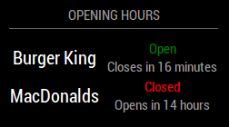

# MMM-OpeningHours

[](LICENSE)
[](https://saythanks.io/to/Menturan)

MagicMirror module that displays places' opening hours.
Relies on the [Google Places API (New)](https://developers.google.com/maps/documentation/places/web-service/op-overview).

> **Fork notice.** This is a fork of [Menturan/MMM-OpeningHours](https://github.com/Menturan/MMM-OpeningHours),
> written by Menturan and contributors and licensed under GPL-3.0. Modified in November 2026 by htilly:
> migrated to Places API (New), removed the deprecated `@google/maps` client, and fixed opening hours bugs.
> See the git history for details.

## Screenshot


## Prerequisite: Google API key

You need a Google Cloud API key with **Places API (New)** enabled.

Google has moved the old Places API into legacy status, and **new Google Cloud projects can no longer enable
"Places API" (Legacy)**. If you create a project today you must use Places API (New). This module uses it by default.

1. Open the [Google Cloud console](https://console.cloud.google.com/) and create (or pick) a project.
2. Set up billing for the project. The Places API needs a billing account even if you stay within the free usage.
3. Enable **Places API (New)**: [APIs & Services → Library → "Places API (New)"](https://console.cloud.google.com/apis/library/places.googleapis.com).
   Do not confuse it with "Places API", which is the legacy one.
4. Create an API key under **APIs & Services → Credentials → Create credentials → API key**.
5. Restrict the key: under *API restrictions* pick **Places API (New)** only. The key is used server side
   by MagicMirror's node helper, so leave *Application restrictions* at *None* or use *IP addresses* if your
   mirror has a static public IP. Do not use *HTTP referrers*: the request does not come from a browser.
6. Put the key in `googleApiKey` in your MagicMirror config.

Google's own guide: [Use API keys](https://developers.google.com/maps/documentation/places/web-service/get-api-key).

### Billing

**Opening hours are a billed field. Contributors to this module are not responsible for any charges.**

The module asks for the fields `id`, `displayName`, `currentOpeningHours` and `regularOpeningHours`.
The opening hours fields put each request in the **Place Details Enterprise** SKU. Each place costs
one request per `scheduleTime` (default once every 24 hours), and the module does not fetch again when the
browser reloads. With the default schedule, 5 places is about 150 requests a month.
Check [Places API usage and billing](https://developers.google.com/maps/documentation/places/web-service/usage-and-billing)
for current prices and free usage caps. Setting a [quota](https://console.cloud.google.com/apis/api/places.googleapis.com/quotas)
on the API is a cheap safety net.

If a fetch fails, the module keeps showing the last known hours and retries after 1, 5 and 30 minutes,
then every 30 minutes until it succeeds. Each retry is billed like a normal request. A failure that never
clears, such as an invalid API key, adds about 48 requests per place per day.

### Existing projects with Places API (Legacy)

If your Cloud project already has the legacy Places API enabled, you can keep using it with
`useLegacyApi: true`. Google has not announced a shutdown date, but it is a legacy product, so moving to
Places API (New) is recommended. If you use both, Google recommends a separate API key for each.

## Install

```bash
cd ~/MagicMirror/modules
git clone https://github.com/htilly/MMM-OpeningHours.git
```

The module has no runtime dependencies, so there is no `npm install` step. It uses MagicMirror's built-in
`moment` and Node's built-in `fetch`. It requires Node.js 22 or later, which current MagicMirror also requires.

## Find places ID
Search for the place to get its ID. You really need to **search** for a place. Clicking on a place won't cut it.
Place IDs work the same in the legacy and the new API, so existing configs keep working.

[Place ID Finder](https://developers.google.com/maps/documentation/javascript/examples/places-placeid-finder)

## Configuration

| Key          | Value             | Required | Default           | Description                                                                                                                                                                                             |
|--------------|-------------------|----------|-------------------|---------------------------------------------------------------------------------------------------------------------------------------------------------------------------------------------------------|
| googleApiKey | _string_          | Yes      | N/A               | Your Google API key with Places API (New) enabled. [See above.](#prerequisite-google-api-key)                                                                                                                                                                           |
| places       | [See below.](#places-config)        | Yes      | N/A               | List of place ids. [See above.](#find-places-id)                                                                                                                                                        |
| scheduleTime | _milliseconds_    | No       | 86400000 (24h)    | Time between fetching place data from Google.                                                                                                                                                           |
| timeFormat   | _number_          | No       | config.timeFormat | 24h, 12h. If not specified, uses same as parent config.                                                                                                                                                 |
| language     | _ISO 639-1  code_ | No       | config.language   | Changes the translation. Time and date is still locale. Two letter country code. [ISO 639-1 code](https://en.wikipedia.org/wiki/List_of_ISO_639-1_codes). If not specified, uses same as parent config. |
| styling      | _object_          | No       | See next table.   | Configure table style.
| useLegacyApi | _boolean_         | No       | false             | Use Places API (Legacy) instead of Places API (New). Only for Cloud projects that already have the legacy API enabled. |
| debug        | _boolean_         | No       | false             | Debug output.                                                                                                                                                                                           |
| mockData     | _boolean_         | No       | false             | Fake API call. Shows the recorded responses in `mock_data/places_new/` (or `mock_data/` with `useLegacyApi`). Used for development.                                                                                                                                                                    |

### Places config
Places are provided as a list `[]`. Example - `["place_id_1", "place_id_2", "place_id_3"]`.

If you would like to use an alias for a place you put the place id and the alias in a list with the **place id first**. Example - `["place_id_1", ["place_id_2", "Place 2"], "place_id_3"]`.

#### Styling

| Key           | Value     | Required | Default | Description                                                           |
|---------------|-----------|----------|---------|-----------------------------------------------------------------------|
| showTimeUntil | _boolean_ | No       | false   | Show time until close/open instead of time when closed/open.          |
| textAlign     | _string_  | No       | center  | Table text alignment. Possible values: left, right, center.           |
| size          | _string_  | No       | small   | Size of table. Possible values: xsmall, small, medium. large, xlarge. |


## Example config

```js
{
    module: "MMM-OpeningHours",
    position: "bottom_right",
    header: "Opening hours",
    config: {
        googleApiKey: "XXXXXXXXXXXXXX",
        places: ["xxxxxxxx", ["yyyyyyyy", "Alias y"]],
        styling: {
          size: 'small'
        }
    }
}
```
## Development

```bash
npm install
npm test
```

The tests never call Google. They use recorded responses in `mock_data/` (Places API (Legacy)) and
`mock_data/places_new/` (Places API (New)). Add a file there to cover a new case; with `mockData: true` the
module shows every file in the folder on the mirror.

If you find a bug or have a feature request, open an issue or, even better, a pull request.
